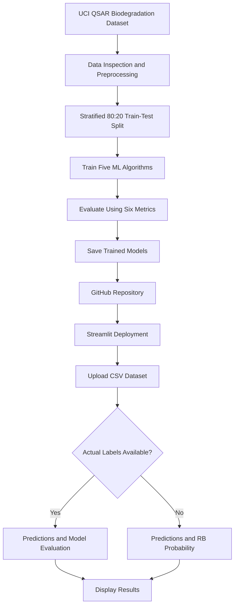

# 🧪 QSAR Biodegradation Classification Using Machine Learning

<p align="center">
  <strong>BITS Pilani | Work Integrated Learning Programmes</strong><br>
  M.Tech – Artificial Intelligence and Machine Learning<br>
  <strong>Machine Learning Assignment 2</strong>
</p>

<p align="center">
  <a href="https://github.com/manikandan2711/QSAR_Biodegradation_ML_Assignment2">
    
  </a>
  <a href="https://qsarbiodegradationmlassignment2-4uxkwa7blhwx4bfyczqjvb.streamlit.app/">
    
  </a>
  <a href="https://archive.ics.uci.edu/dataset/254/qsar+biodegradation">
    
  </a>
</p>

<p align="center">
  
  
  
  
</p>

---

## 👨‍🎓 Project Information

| Detail | Information |
|---|---|
| **Institution** | BITS Pilani – WILP |
| **Programme** | M.Tech (AIML) |
| **Student Name** | Manikandan Velmurugan |
| **Student ID** | 2026AJ05741 |
| **Assignment** | Machine Learning – Assignment 2 |
| **Project** | QSAR Biodegradation Classification |

---

## 📌 1. Project Overview

The objective of this project is to develop and compare five supervised machine learning classification algorithms to predict the biodegradability of chemical compounds using their molecular descriptor features.

The classification task identifies whether a chemical compound is:

- 🟢 **Ready Biodegradable (RB)** – Positive class (`1`)
- 🔴 **Not Ready Biodegradable (NRB)** – Negative class (`0`)

Five machine learning algorithms are trained and evaluated using a common dataset and an independent stratified test split.

The trained models are saved and integrated into an interactive Streamlit application, allowing users to evaluate labelled datasets and generate predictions from features-only datasets without retraining the models.

## 📊 2. Dataset Description

**Dataset:** QSAR Biodegradation  
**Source:** UCI Machine Learning Repository

🔗 [View Original Dataset](https://archive.ics.uci.edu/dataset/254/qsar+biodegradation)

### Dataset Statistics

| Attribute | Description |
|---|---|
| Total instances | 1,055 |
| Input features | 41 molecular descriptors |
| Target variable | Biodegradability class |
| Classification type | Binary classification |
| Missing values | None in the supplied dataset |
| Training data | 844 instances (80%) |
| Testing data | 211 instances (20%) |
| Random state | 42 |

### Class Distribution

| Class | Encoded Value | Instances |
|---|---:|---:|
| Ready Biodegradable (RB) | 1 | 356 |
| Not Ready Biodegradable (NRB) | 0 | 699 |
| **Total** | | **1,055** |

The dataset contains molecular descriptor values representing chemical characteristics of compounds. These descriptors are used as input features for the classification algorithms.

### Data Preprocessing

- Checked the supplied dataset for missing values.
- Encoded the target classes as RB = 1 and NRB = 0.
- Applied a stratified 80:20 train-test split.
- Used `random_state=42` for reproducibility.
- Applied `StandardScaler` within the saved pipelines for Logistic Regression, KNN and SVM.
- Used the same training and testing partitions across all five models.

The preprocessing steps are fitted using training data and applied consistently during evaluation and inference.

---

## ⚙️ 3. Machine Learning Algorithms

Five supervised classification algorithms are implemented.

| Algorithm | Description |
|---|---|
| Logistic Regression | Linear classification model based on logistic probability estimation. |
| Decision Tree | Tree-based classifier that learns decision rules from input features. |
| K-Nearest Neighbors (KNN) | Classifies samples using the nearest observations in feature space. |
| Gaussian Naive Bayes | Probabilistic classifier based on Bayes' theorem and Gaussian feature assumptions. |
| Support Vector Machine (SVM) | Margin-based classifier using an RBF kernel to capture nonlinear patterns. |

All five algorithms are trained on the same training partition and evaluated on the same independent test partition.

---

## 🏆 4. Model Performance Comparison

The models are evaluated using six mandatory classification metrics.

### Evaluation Results

| ML Model | Accuracy | AUC | Precision | Recall | F1 Score | MCC |
|---|---:|---:|---:|---:|---:|---:|
| **Logistic Regression** | **0.8626** | 0.9136 | **0.8000** | 0.7887 | **0.7943** | **0.6912** |
| Decision Tree | 0.8152 | 0.7844 | 0.7424 | 0.6901 | 0.7153 | 0.5796 |
| KNN | 0.8531 | 0.8973 | 0.7703 | **0.8028** | 0.7862 | 0.6747 |
| Naive Bayes | 0.6967 | 0.8650 | 0.5276 | **0.9437** | 0.6768 | 0.4972 |
| SVM | 0.8483 | **0.9189** | 0.7910 | 0.7465 | 0.7681 | 0.6562 |

### 🥇 Performance Highlights

| Evaluation Metric | Best Performing Model | Score |
|---|---|---:|
| Accuracy | Logistic Regression | 86.26% |
| AUC | SVM | 0.9189 |
| Precision | Logistic Regression | 0.8000 |
| Recall | Naive Bayes | 0.9437 |
| F1 Score | Logistic Regression | 0.7943 |
| MCC | Logistic Regression | 0.6912 |

### Model Performance Observations

**1. Logistic Regression**

Achieved the highest accuracy (0.8626), precision (0.8000), F1 score (0.7943) and MCC (0.6912). It demonstrated the strongest overall balance among the evaluated models.

**2. Decision Tree**

Provides interpretable nonlinear decision rules. However, it achieved the lowest AUC (0.7844), indicating comparatively weaker class discrimination on the selected test split.

**3. K-Nearest Neighbors**

Achieved the second-highest accuracy (0.8531) and F1 score (0.7862). Its recall (0.8028) was higher than Logistic Regression. Feature scaling is important because KNN relies on distance calculations.

**4. Gaussian Naive Bayes**

Achieved the highest recall (0.9437), identifying a large proportion of actual RB compounds. However, its precision (0.5276) and accuracy (0.6967) were lower, indicating a higher number of false-positive predictions.

**5. Support Vector Machine**

Achieved the highest AUC (0.9189), demonstrating strong discrimination between the two classes across different classification thresholds. It uses an RBF kernel with probability estimation enabled.

### ⭐ Overall Model Assessment

**Logistic Regression is the strongest overall model on this test split**, leading in four of the six evaluation metrics: Accuracy, Precision, F1 Score and MCC.

SVM achieved the highest AUC, while Naive Bayes achieved the highest Recall. The choice of model depends on the relative importance of false-positive and false-negative predictions.

---

## 📖 5. Evaluation Metrics

The following metrics are used to evaluate the classification performance:

| Metric | Interpretation |
|---|---|
| **Accuracy** | Proportion of total predictions that are correct. |
| **AUC** | Measures the model's ability to distinguish between classes across classification thresholds. |
| **Precision** | Proportion of predicted positive cases that are actually positive. |
| **Recall** | Proportion of actual positive cases correctly identified. |
| **F1 Score** | Harmonic mean of precision and recall. |
| **MCC** | Balanced correlation measure based on all four confusion matrix outcomes, ranging from -1 to +1. |

In this project, Ready Biodegradable (RB) is treated as the positive class.

---

## 🌐 6. Interactive Streamlit Application

The trained machine learning models are deployed through an interactive Streamlit web application.

<p align="center">
  <a href="https://qsarbiodegradationmlassignment2-4uxkwa7blhwx4bfyczqjvb.streamlit.app/">
    
  </a>
</p>

### Application Capabilities

- 📁 Upload CSV files for evaluation or prediction.
- 🤖 Select any of the five saved machine learning models.
- 📊 Display six evaluation metrics for labelled datasets.
- 📉 Display confusion matrix and classification report.
- 🔍 Preview uploaded test data.
- 🎯 Generate predicted classes and labels.
- 📈 Display RB prediction probabilities.
- 📥 Download prediction results as a CSV file.

### Supported Input Scenarios

**Scenario 1 – Labelled Test Dataset**

When a CSV containing actual target labels (`target` or `class`) is uploaded, the application:

- Generates model predictions.
- Calculates Accuracy, AUC, Precision, Recall, F1 and MCC.
- Displays the confusion matrix.
- Displays the classification report.

**Scenario 2 – Features-Only Dataset**

When a CSV containing only the 41 molecular descriptor features is uploaded, the application:

- Generates predictions without requiring actual labels.
- Displays the predicted class (0 or 1).
- Displays the predicted label (RB or NRB).
- Displays RB prediction probability as a percentage.
- Provides a downloadable CSV containing prediction results.

Since actual labels are unavailable in this scenario, evaluation metrics and confusion matrices are not calculated.

### Model Persistence and Inference

The Streamlit application loads the selected pre-trained model from the `model/` directory.

**Important:** The application does not retrain models using uploaded test data. It performs inference and evaluation using the saved model artifacts.

---

## 🔄 7. Project Workflow



---

## 📁 8. GitHub Repository Structure

```text
QSAR_Biodegradation_ML_Assignment2/
│
├── app.py
├── train_models.py
├── requirements.txt
├── README.md
├── biodeg.csv
├── test_data.csv
├── model_metrics.csv
├── metadata.json
├── SUBMISSION_CHECKLIST.txt
│
└── model/
    ├── logistic_regression.joblib
    ├── decision_tree.joblib
    ├── knn.joblib
    ├── naive_bayes.joblib
    └── svm.joblib
```

### Important Project Files

| File | Purpose |
|---|---|
| `app.py` | Streamlit application for model selection, evaluation and prediction. |
| `train_models.py` | Data preprocessing, model training, evaluation and model persistence. |
| `biodeg.csv` | Original QSAR biodegradation dataset. |
| `test_data.csv` | Independent test dataset containing features and actual labels. |
| `model_metrics.csv` | Evaluation results for the five models. |
| `metadata.json` | Model and project metadata. |
| `requirements.txt` | Python dependency specifications. |
| `model/` | Saved machine learning model artifacts. |

---

## 💻 9. Installation and Execution

### Prerequisites

- Python 3.x
- Git
- pip package manager

### Step 1 – Clone the Repository

```bash
git clone https://github.com/manikandan2711/QSAR_Biodegradation_ML_Assignment2.git
```

### Step 2 – Navigate to the Project Directory

```bash
cd QSAR_Biodegradation_ML_Assignment2
```

### Step 3 – Install Dependencies

```bash
python -m pip install -r requirements.txt
```

### Step 4 – Train and Save Models (Optional)

```bash
python train_models.py
```

This regenerates the model artifacts, test dataset and evaluation metrics using the configured training workflow.

### Step 5 – Launch the Streamlit Application

```bash
streamlit run app.py
```

Open the local URL displayed in the terminal to access the application.

---

## ☁️ 10. Streamlit Community Cloud Deployment

The application is deployed using Streamlit Community Cloud and connected to the GitHub repository.

Deployment configuration:

| Setting | Value |
|---|---|
| Repository | `QSAR_Biodegradation_ML_Assignment2` |
| Branch | `main` |
| Main application file | `app.py` |
| Platform | Streamlit Community Cloud |

The application is publicly accessible through the following link:

🔗 [Launch QSAR Biodegradation Classification App](https://qsarbiodegradationmlassignment2-4uxkwa7blhwx4bfyczqjvb.streamlit.app/)

The deployed application loads saved models from the repository and supports both labelled dataset evaluation and features-only prediction.

---

## 🔁 11. Reproducibility

The `train_models.py` script regenerates the saved model artifacts, `test_data.csv` and `model_metrics.csv`.

The implementation uses:

- Stratified 80:20 train-test split.
- Fixed random state of 42.
- Common training and testing partitions across all five models.
- Saved preprocessing and classification pipelines where applicable.

This provides a consistent basis for comparing model performance.

Results may vary if the dataset, preprocessing steps, hyperparameters, random seed or package versions are modified.

---

## 🎯 12. Conclusion

This project demonstrates the application of supervised machine learning techniques to QSAR biodegradation classification.

Five classification algorithms were implemented and compared using six evaluation metrics.

Logistic Regression demonstrated the strongest overall balance across accuracy, precision, F1 score and MCC. SVM achieved the highest AUC, while Gaussian Naive Bayes achieved the highest recall.

The project also demonstrates model persistence and deployment through a Streamlit application, supporting both labelled dataset evaluation and features-only prediction.

Overall, the implementation covers the complete machine learning workflow, including dataset preparation, preprocessing, model training, performance evaluation, model persistence, GitHub version control and web application deployment.

---

<p align="center">
  <strong>Machine Learning Assignment 2</strong><br>
  BITS Pilani – Work Integrated Learning Programmes<br>
  M.Tech (Artificial Intelligence and Machine Learning)<br><br>
  <strong>Student:</strong> Manikandan Velmurugan<br>
  <strong>Student ID:</strong> 2026AJ05741
</p>

<p align="center">
  <sub>QSAR Biodegradation Classification | Machine Learning Project</sub>
</p>
